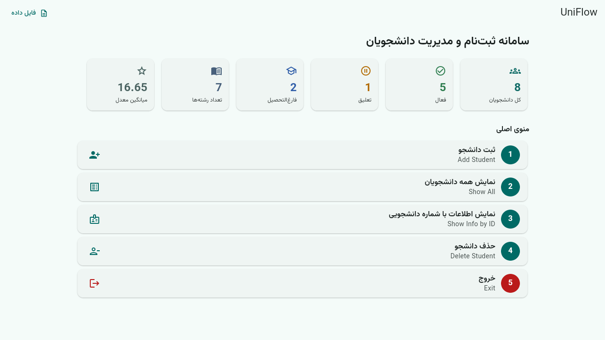
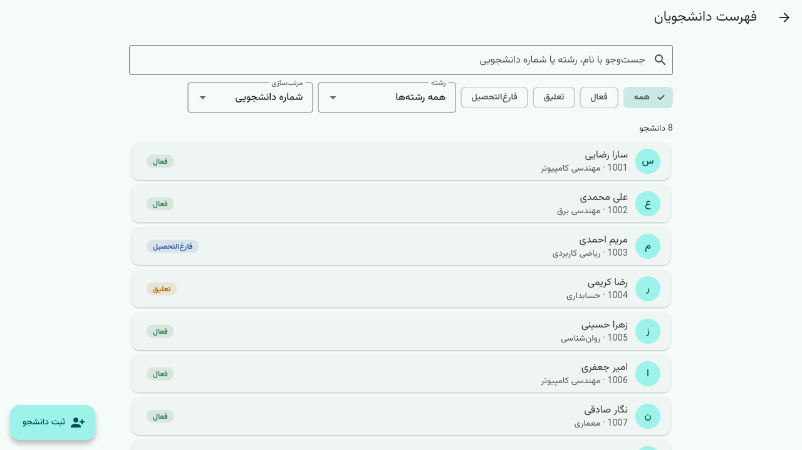
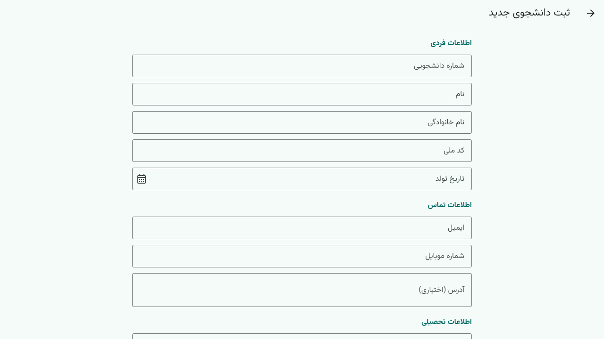
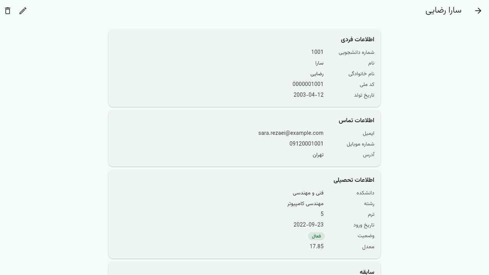
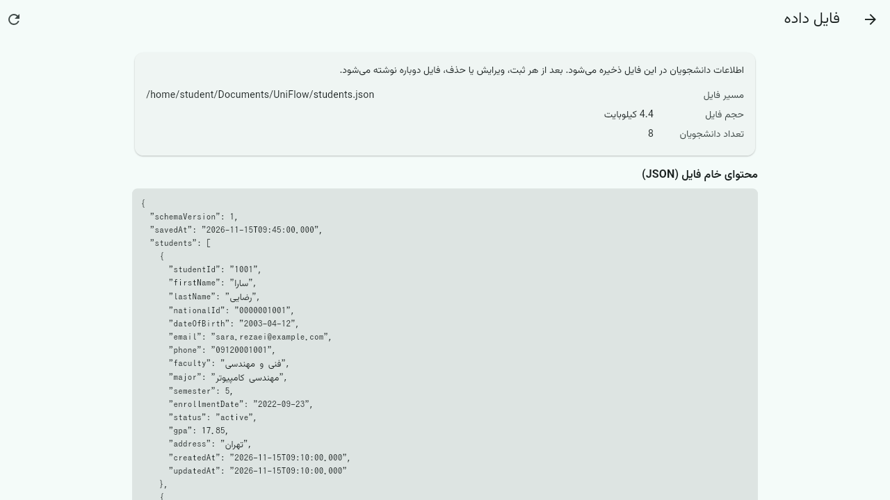
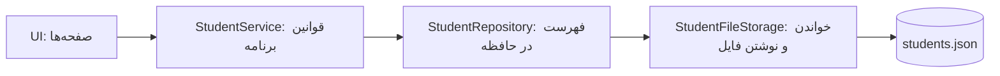

# UniFlow

<div dir="rtl">

**سامانه ثبت‌نام و مدیریت دانشجویان** — پروژه درس برنامه‌نویسی موبایل

یک برنامه Flutter برای لینوکس (اوبونتو) که اطلاعات دانشجویان را در یک فایل JSON روی همان کامپیوتر ذخیره می‌کند. اطلاعات با بستن برنامه از بین نمی‌رود و در اجرای بعدی دوباره خوانده می‌شود.



## الزامات پروژه

| گزینه | در برنامه |
|---|---|
| Save in File | ذخیره در فایل `students.json` بعد از هر تغییر و خواندن آن هنگام شروع برنامه |
| 1. Add Student | فرم ثبت با بررسی همه فیلدها و جلوگیری از ثبت شماره دانشجویی تکراری |
| 2. Show All | فهرست همه دانشجویان |
| 3. Show Info by ID | نمایش اطلاعات کامل یک دانشجو با شماره دانشجویی |
| 4. Delete Student | حذف با شماره دانشجویی، بعد از گرفتن تأیید |
| 5. Exit | خروج از برنامه بعد از گرفتن تأیید |

## امکانات بیشتر

- آمار صفحه اصلی: تعداد کل دانشجویان، فعال، تعلیق، فارغ‌التحصیل، تعداد رشته‌ها و میانگین معدل
- ویرایش اطلاعات دانشجو (شماره دانشجویی قابل تغییر نیست)
- جست‌وجو با نام، رشته یا شماره دانشجویی
- فیلتر بر اساس وضعیت تحصیلی و رشته
- مرتب‌سازی بر اساس شماره دانشجویی، نام خانوادگی (به ترتیب الفبای فارسی) یا جدیدترین ثبت
- ثبت زمان ایجاد و آخرین ویرایش هر دانشجو
- صفحه «فایل داده» که مسیر فایل، حجم آن و محتوای خام JSON را نشان می‌دهد
- محافظت از اطلاعات: نوشتن امن فایل، کنار گذاشتن فایل خراب به‌جای رونویسی آن، و جلوگیری از ثبت کد ملی تکراری
- رابط فارسی و راست‌چین با فونت وزیرمتن. ارقام فارسی هم در ورودی‌ها پذیرفته می‌شوند.
- ۶۹ تست خودکار

## تصاویر

| فهرست دانشجویان | فرم ثبت دانشجو |
|---|---|
|  |  |
| **جزئیات دانشجو** | **فایل داده** |
|  |  |

همه نام‌ها، شماره‌ها و ایمیل‌های تصاویر ساختگی هستند.

## پیش‌نیازها

- اوبونتو (روی Ubuntu 24.04 تست شده است)
- Flutter 3.50 و Dart 3.14
- ابزارهای ساخت برنامه لینوکس:

</div>

```bash
sudo apt install clang cmake ninja-build pkg-config libgtk-3-dev liblzma-dev libstdc++-12-dev
```

<div dir="rtl">

## اجرا

</div>

```bash
git clone https://github.com/Moh4mmadNSZ/UniFlow.git
cd UniFlow
flutter pub get
flutter run -d linux
```

<div dir="rtl">

ساخت نسخه نهایی و اجرای آن:

</div>

```bash
flutter build linux --release
./build/linux/x64/release/bundle/uniflow
```

<div dir="rtl">

اجرای تست‌ها و بررسی کد:

</div>

```bash
flutter test
flutter analyze
```

<div dir="rtl">

## فایل داده کجاست؟

اطلاعات در پوشه UniFlow داخل پوشه Documents کاربر ذخیره می‌شود. مسیر دقیق در صفحه «فایل داده» داخل برنامه نمایش داده می‌شود.

</div>

```bash
cat ~/Documents/UniFlow/students.json
```

<div dir="rtl">

نمونه محتوای فایل:

</div>

```json
{
  "schemaVersion": 1,
  "savedAt": "2026-11-15T10:32:08.512",
  "students": [
    {
      "studentId": "1001",
      "firstName": "سارا",
      "lastName": "رضایی",
      "nationalId": "0000001001",
      "dateOfBirth": "2003-04-12",
      "email": "sara.rezaei@example.com",
      "phone": "09120001001",
      "faculty": "فنی و مهندسی",
      "major": "مهندسی کامپیوتر",
      "semester": 5,
      "enrollmentDate": "2022-09-23",
      "status": "active",
      "gpa": 17.85,
      "address": null,
      "createdAt": "2026-11-15T09:10:00.000",
      "updatedAt": "2026-11-15T09:10:00.000"
    }
  ]
}
```

<div dir="rtl">

## ساختار برنامه

هر لایه فقط با لایه کناری خودش کار می‌کند:

</div>



```text
lib/
├── main.dart                             start the app and build the layers
├── app.dart                              theme, Persian locale, first screen
├── models/student.dart                   Student class and JSON conversion
├── storage/student_file_storage.dart     read and write the data file
├── repositories/student_repository.dart  in-memory list and CRUD
├── services/student_service.dart         rules, search, filters, stats
├── utils/                                validators, exceptions, faculties, helpers
└── ui/                                   theme, screens and widgets
test/                                     automated tests
```

<div dir="rtl">

## محدودیت‌ها

- برنامه یک‌کاربره و آفلاین است.
- با هر تغییر، کل فایل دوباره نوشته می‌شود. این روش برای چند هزار دانشجو مناسب است، ولی برای تعداد خیلی بیشتر بهتر است از پایگاه داده (مثل SQLite) استفاده شود.
- تاریخ‌ها میلادی هستند.
- در وب اجرا نمی‌شود، چون در مرورگر نمی‌توان با `dart:io` روی فایل نوشت.

## فونت

فونت [وزیرمتن](https://github.com/rastikerdar/vazirmatn) با مجوز SIL Open Font License همراه برنامه است. متن مجوز در `assets/fonts/OFL.txt` قرار دارد.

</div>
